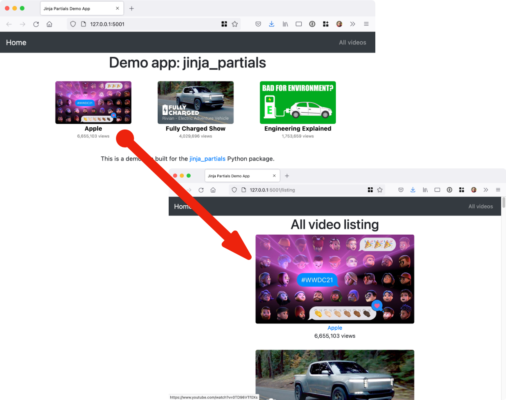

# Jinja Partials

Simple reuse of partial HTML page templates in the Jinja template language for Python web frameworks.
(There is also a [Pyramid/Chameleon version here](https://github.com/mikeckennedy/chameleon_partials).)

## Overview

Every Jinja2 app of a certain age has a fragment that got copied. A video card, a badge, a table row. It started life on one page, got pasted onto a second, then a third, and by the time the designer asks for a small refresh there are fourteen of them and two have quietly drifted. In Python this never happens, because you would write a function with parameters and call it from everywhere. jinja_partials gives your templates that same move:

```html
{{ render_partial('shared/partials/video_square.html', video=v) }}
```

That one call renders the fragment file with the data you hand it, and nothing else, and gives back HTML that is safe to drop straight into the page. Fragments nest as deep as the design needs. Every input is visible at the call site. And because a partial is just a template, the same file can render inline inside a page and be served on its own to an HTMX swap.

## Documentation

The full documentation is available at [mkennedy.codes/docs/jinja-partials](https://mkennedy.codes/docs/jinja-partials/). This README is the short version; the user guide tells the whole story:

- [Why partials](https://mkennedy.codes/docs/jinja-partials/user-guide/why-partials.html) - the fourteenth copy of a video card, and how `render_partial` differs from `include` and `macro`
- [Installation](https://mkennedy.codes/docs/jinja-partials/user-guide/installation.html) and the [Quickstart](https://mkennedy.codes/docs/jinja-partials/user-guide/quickstart.html), which builds that card properly, once
- [Frameworks](https://mkennedy.codes/docs/jinja-partials/user-guide/frameworks.html) - Flask, Quart, FastAPI, Starlette, plain Jinja2, the declarative extension, and the one rule async apps must follow
- [Troubleshooting](https://mkennedy.codes/docs/jinja-partials/user-guide/troubleshooting.html) - a field guide to every error and wrong output, with the fix for each
- [Testing partials](https://mkennedy.codes/docs/jinja-partials/user-guide/testing.html), [How it works](https://mkennedy.codes/docs/jinja-partials/user-guide/how-it-works.html), and the [FAQ](https://mkennedy.codes/docs/jinja-partials/user-guide/faq.html)
- [API reference](https://mkennedy.codes/docs/jinja-partials/reference/)

Coding agents can load the [agent skill](https://mkennedy.codes/docs/jinja-partials/skill.md) or read [llms-full.txt](https://mkennedy.codes/docs/jinja-partials/llms-full.txt).

## Supported Frameworks

Your templates never find out which framework is running them. `{{ render_partial(...) }}` looks the same in a Flask app from 2019 and a FastAPI app you started this morning. The only thing that changes is one registration line at startup:

- **Flask** - `register_extensions(app)`
- **FastAPI** - `register_fastapi_extensions(app, templates)`
- **Starlette** - `register_starlette_extensions(templates, app=app)`
- **Quart** - `register_quart_extensions(app)`
- **Any Jinja2 environment** - `register_environment(env)`

Under every one of those is the same tiny primitive. The framework helpers only differ in how they find the Jinja environment and, for the async frameworks, how they keep a small render thread pool alive for exactly as long as the app is serving.

## Examples

The [`examples`](https://github.com/mikeckennedy/jinja_partials/tree/main/examples) folder holds a runnable app for each framework:

- [**Flask example**](https://github.com/mikeckennedy/jinja_partials/tree/main/examples/example_flask) - the complete video site from this README, with a layout, a listing page, and a small JSON database of videos
- [**FastAPI example**](https://github.com/mikeckennedy/jinja_partials/tree/main/examples/example_fastapi) - an `enable_async=True` environment rendering cards with nested badge partials
- [**Starlette example**](https://github.com/mikeckennedy/jinja_partials/tree/main/examples/example_starlette) - the same cards and badges on Starlette, with lifespan-managed rendering
- [**Quart example**](https://github.com/mikeckennedy/jinja_partials/tree/main/examples/example_quart) - the async Flask cousin, rendering the same cards through `before_serving` and `after_serving` hooks

The three async examples are deliberately small and nearly identical, so you can diff them and see that the templates are the part that does not change. The screenshot below is the Flask example, and every card on it is one partial file rendered in a loop:



## Installation

It's just `pip install jinja-partials` (or `uv add jinja-partials`) and you're all set with this pure Python package. The PyPI name has a hyphen and the import has an underscore, `import jinja_partials`, which is the first and only trap at the door.

Requires Python 3.10 or newer. On older interpreters pip does not refuse; it quietly hands you the 0.3.0 release, which predates the Quart and FastAPI support and the lifecycle-managed Starlette support described here. If a function on this page is mysteriously missing, check which version you actually got.

## Usage

Register jinja_partials with your framework once, where the app is built, before it starts serving. After that the `render_partial` function is simply there in every template, like `url_for`. The [Frameworks](https://mkennedy.codes/docs/jinja-partials/user-guide/frameworks.html) page covers each option in more depth, including the page-level rule for async apps.

### Flask

Flask is the original home of this library and gets the richest behavior. Partials render through `flask.render_template`, so context processors, `g`, `request`, and `session` all work inside them exactly as they do in a page.

```python
import flask
import jinja_partials

app = flask.Flask(__name__)
jinja_partials.register_extensions(app)
```

### FastAPI

Registration wraps the app's lifespan, so the render pool exists for exactly as long as the app is serving. If you already pass a `lifespan=` to FastAPI, it keeps running and whatever state it yields still reaches your routes.

```python
from fastapi import FastAPI
from fastapi.templating import Jinja2Templates
import jinja_partials

app = FastAPI()
templates = Jinja2Templates(directory='templates')

jinja_partials.register_fastapi_extensions(app, templates)
```

### Starlette

Read the last line twice: `templates` comes first and `app` is a keyword, the reverse of the FastAPI call. Starlette support predates the app-aware version and kept its original first argument. Passing the app is optional but recommended, because that is what ties the render pool to the lifespan.

```python
from starlette.applications import Starlette
from starlette.templating import Jinja2Templates
import jinja_partials

templates = Jinja2Templates(directory='templates')
app = Starlette(routes=[...])

jinja_partials.register_starlette_extensions(templates, app=app)
```

### Quart

Quart templates are async, and registration adds `before_serving` and `after_serving` hooks that create and later shut down the pool that renders partials. Your pages keep using `await render_template(...)` as they always did.

```python
from quart import Quart
import jinja_partials

app = Quart(__name__)
jinja_partials.register_quart_extensions(app)
```

### One rule for async apps

Quart, FastAPI, and Starlette apps usually build their Jinja environment with `enable_async=True`. jinja_partials handles the partials inside those templates with no changes on your side. The page that contains them is your job, and there is exactly one rule: in FastAPI and Starlette, render it with `await template.render_async(...)` and return an `HTMLResponse`. The tempting `templates.TemplateResponse(...)` calls the synchronous `render()`, which tries to start an event loop inside the one already running your request, and Python declines with `RuntimeError: asyncio.run() cannot be called from a running event loop`. The partials were never the problem; the page was.

```python
from fastapi.responses import HTMLResponse


@app.get('/')
async def index() -> HTMLResponse:
    template = templates.get_template('home/index.html')
    return HTMLResponse(await template.render_async(items=items))
```

### Direct Jinja2 Environment

No framework, or one the library has not heard of? Register with the environment directly. The `markup=True` is not decoration: this is the one registration function whose `markup` defaults to `False`, and with autoescaping on, the default inserts your fragment as escaped text.

```python
from jinja2 import Environment, FileSystemLoader
import jinja_partials

environment = Environment(loader=FileSystemLoader('templates'))
jinja_partials.register_environment(environment, markup=True)
```

### Using the Jinja2 Extension (Declarative)

If your framework or settings file configures Jinja declaratively, `PartialsJinjaExtension` performs the same registration from the environment's `extensions` list, always with markup enabled.

#### For Flask Applications

With Flask, add the extension to your app's Jinja environment:

```python
import flask
import jinja_partials

app = flask.Flask(__name__)

# Declarative registration with Flask
app.jinja_env.add_extension('jinja_partials.PartialsJinjaExtension')

# Alternative: traditional registration
# jinja_partials.register_extensions(app)
```

> **Note:** With the extension approach, partials render directly through the Jinja environment rather than `flask.render_template`. That means Flask context processors (`@app.context_processor`) and the `template_rendered` signal do not apply inside partials (`g`, `request`, and `session` still work, since Flask installs them as environment globals). If your partials depend on context processors, use `jinja_partials.register_extensions(app)`.

#### For Standalone Jinja2 Environments

For direct Jinja2 usage (without Flask):

```python
from jinja2 import Environment, FileSystemLoader

# Declarative registration - extension automatically registers render_partial
environment = Environment(
    loader=FileSystemLoader('tests/test_templates'), extensions=['jinja_partials.PartialsJinjaExtension']
)
# render_partial is now available in templates, no additional setup needed!
```

#### When to Use the Extension Approach

Reach for the extension when the environment is configured somewhere you do not control the Python, such as a framework or settings file that takes a list of extension names, or when you are already stacking other Jinja2 extensions and want this one listed beside them. It always enables markup, so your partials come back as `Markup` objects and autoescaping leaves them alone.

## Template Usage

Here is the video card from the screenshot, built once. Partials are ordinary templates, so they can live anywhere your loader can see. The convention this project uses is a `partials` folder under `templates/shared`:

```text
├── templates
│   ├── home
│   │   ├── index.html
│   │   └── listing.html
│   └── shared
│       ├── _layout.html
│       └── partials
│           ├── video_image.html
│           └── video_square.html
```

Start with the smallest piece. The YouTube thumbnail takes a `video` and an optional list of CSS `classes`, and it declares that `classes` is optional by handling its own absence with `| default([])`:

```html

```

Now the card. It wraps the thumbnail in a link, adds the author and the view count, and it gets the thumbnail by rendering the image partial inside itself. Partials nest; that is half their charm.

```html
<div>
    <a href="https://www.youtube.com/watch?v={{ video.id }}" target="_blank">
        {{ render_partial('shared/partials/video_image.html', video=video) }}
    </a>
    <a href="https://www.youtube.com/watch?v={{ video.id }}" target="_blank"
       class="author">{{ video.author }}</a>
    <div class="views">{{ "{:,}".format(video.views) }} views</div>
</div>
```

That is `render_partial()` in the wild. It takes the path of the fragment relative to the templates folder, extension included, and whatever data the fragment needs as keyword arguments.

Finally the page, which turns a list of videos into a grid of cards:

```html


    <div class="col-md-3 video">
        {{ render_partial('shared/partials/video_square.html', video=v) }}
    </div>


```

The page calls the loop variable `v`. The card calls it `video`. That renaming at the boundary is not a workaround; it is the whole idea. The fragment names what it needs, and each caller maps its own data onto those names. The listing page, the search results, and the email digest can all call this one file with whatever they happen to have, and the fragment can never quietly depend on a page variable it was not given.

If a fragment shows up on the page as escaped text, or you hit `PartialsException`, `TemplateNotFound`, or an `asyncio.run()` error in an async app, the [Troubleshooting](https://mkennedy.codes/docs/jinja-partials/user-guide/troubleshooting.html) page starts from what you see on the screen and works back to the fix.

## Why not just use `include` or `macro` from Jinja?

Because both are nearly right, which is exactly why they frustrate. `` hands the fragment the entire page context, so nothing at the call site tells you what it reads. `` has proper parameters but must be imported into every page and is not a file you can render on its own, so it cannot answer an HTMX request by itself. [Why partials](https://mkennedy.codes/docs/jinja-partials/user-guide/why-partials.html) tells the story, and the original debate is on [**issue #1**](https://github.com/mikeckennedy/jinja_partials/issues/1).
